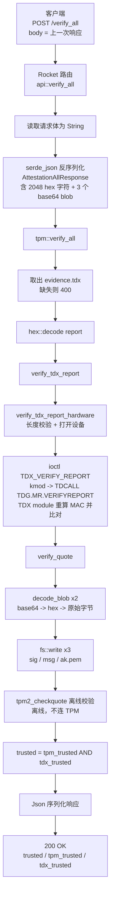
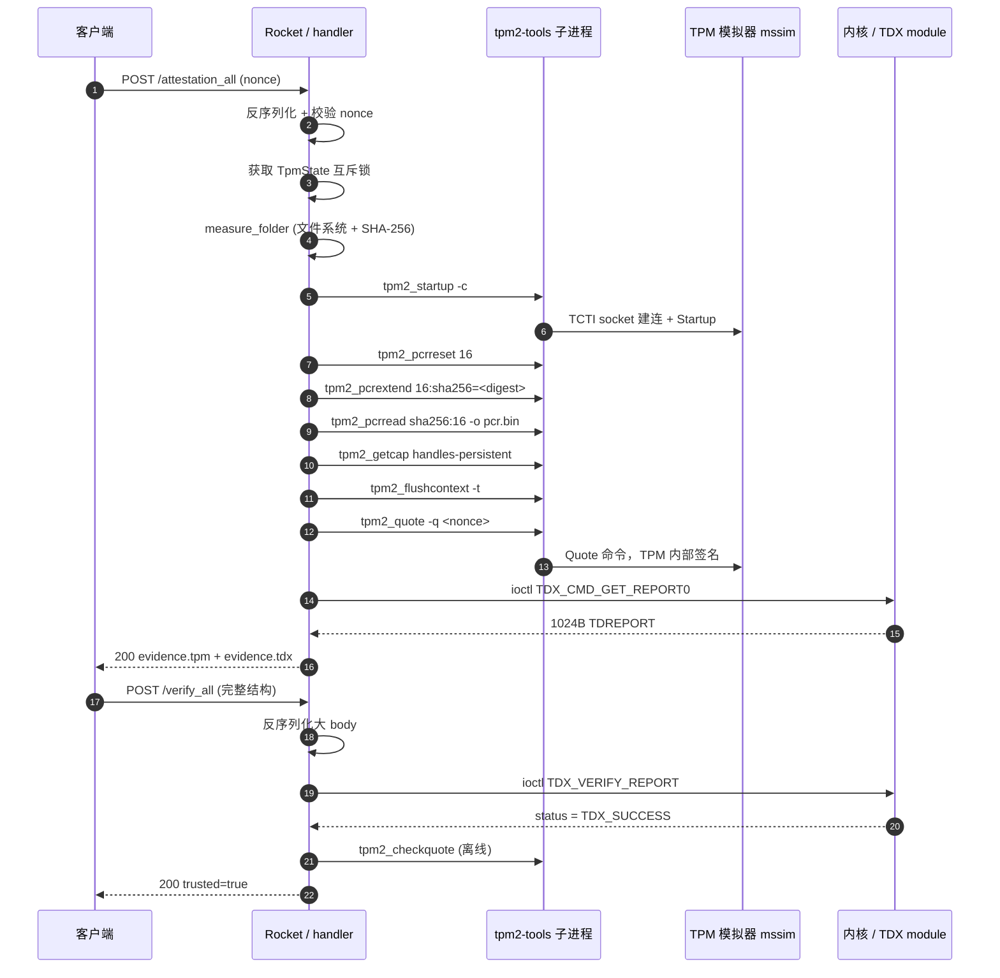
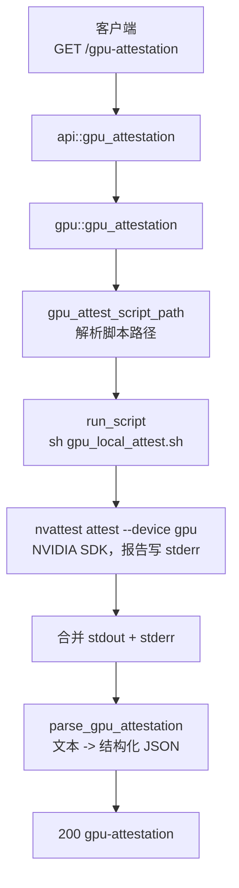

# 远程证明端到端耗时测量方案（流程 + 度量点清单）

> 目标：为 `tex-attestation-server` 的**远程证明流程**建立端到端耗时（E2E latency）与
> **单元级耗时**（per-unit breakdown）的测量口径。
>
> 本文档只做三件事：
>
> 1. 梳理端到端证明的完整流程（含流程图）；
> 2. 列出**需要做时间测量的过程与函数名**；
> 3. 给出度量口径、误差来源与记录格式。
>
> **不包含任何代码修改**。文中出现的 `文件:行号` 均为当前代码的实际位置，可直接跳到该处埋点。

---

## 1. 范围与"端到端"的定义

服务里有三条独立的证明链路，本方案以 **TPM + TDX 组合证明**为主线（它是最完整、也是生产上
真正端到端的一条），GPU 证明作为可选分支列出。

| 链路 | 证明生成 | 证明验证 | 是否纳入本方案 |
|------|----------|----------|----------------|
| TPM + TDX 组合 | `POST /attestation_all` | `POST /verify_all` | **主线，P0** |
| 仅 TPM | `POST /quote_tpm` | 客户端 `tpm2_checkquote` | 复用 TPM 侧度量点 |
| 仅 TDX | `GET /attestation-with-randomnumber` | `POST /verify-report` | 复用 TDX 侧度量点 |
| GPU | `GET /gpu-attestation` | 脚本内部（NVIDIA SDK） | 可选分支，P2 |

"端到端"存在三个不同边界，**必须分别统计、不要混在一张表里**：

| 代号 | 边界 | 起止点 | 用途 |
|------|------|--------|------|
| `E2E-S` | 服务端视角 | Rocket `on_request` 进入 → `on_response` 退出 | 服务端自身性能，与客户端无关 |
| `E2E-C` | 客户端视角 | 客户端发请求 → 收到完整响应体 | 用户实际感知，含网络与 JSON 解析 |
| `E2E-F` | 完整证明闭环 | 发起生成请求 → 验证请求返回 `trusted=true` | 论文/报告中"一次远程证明"的总时间 |

`E2E-F = T_prove + T_verify + T_client_gap`，其中 `T_client_gap` 是两次请求之间客户端自己的耗时
（构造 nonce、解析 JSON、组包），必须单独列出，否则会把客户端开销误记到服务端。

---

## 2. 系统的执行模型（决定了"怎么测"）

理解下面四点，才能正确解释测出来的数字：

1. **全部是同步阻塞代码。** 路由处理函数是普通 `fn`（不是 `async fn`），内部没有任何 `.await`。
   因此一次请求从头到尾跑在 Rocket 的**同一个 worker 线程**上，所有阶段的耗时可**线性相加**，
   不会出现异步交错导致的归因困难。
2. **TPM 侧被一把进程级互斥锁串行化。** `TpmState::lock`（`src/tpm.rs:702`）在
   `tpm::attestation_all`（`src/tpm.rs:1219`）里获取。并发压测时，"排队等锁"的时间会被算进请求
   耗时，但它**不是** TPM 工作量，必须单独扣出。
3. **每一次 TPM 操作 = 一次 `fork/exec` + 一次 TCTI socket 握手。** `tpm::tpm2`
   （`src/tpm.rs:757`）用 `Command::new("tpm2_*").output()` 起子进程。热路径上单次
   `/attestation_all` 要起 **7 个** `tpm2-*` 进程（见 §4.5），进程创建和 mssim 建连很可能
   是最大的单项开销。
4. **验证路径不加锁。** `tpm::verify_all`（`src/tpm.rs:1290`）只读 `state.config()`，不取
   `TpmInner` 锁，因此验证请求之间可并行；`tpm2_checkquote` 是**离线**校验器，不连 TPM。

> 结论：一次 `/attestation_all` 的耗时 ≈ 一串**串行**的"文件系统 + 子进程 + ioctl"；
> 单元耗时之和应当能解释 95% 以上的总数，剩下的残差就是 HTTP 层、序列化和日志。

---

## 3. 端到端流程

### 3.1 证明生成 `POST /attestation_all`

```mermaid
flowchart TD
    C["客户端<br/>POST /attestation_all"] --> R["Rocket 路由<br/>api::attestation_all"]
    R --> RD["读取请求体为 String"]
    RD --> DS["serde_json 反序列化<br/>QuoteTpmRequest"]
    DS --> NM["QuoteTpmRequest::resolved_nonce<br/>+ normalize_nonce 校验十六进制"]
    NM --> LK["TpmState::lock<br/>获取全局 TPM 互斥锁"]
    LK --> SC["Scratch::new<br/>创建本次请求的临时目录"]
    SC --> MAE["measure_and_extend<br/>TPM 度量 + PCR 周期"]

    MAE --> MF["measure_folder<br/>递归度量目录"]
    MF --> CF["collect_regular_files<br/>遍历 + 过滤 + 按路径排序"]
    CF --> FH["逐文件 fs::read + SHA-256<br/>累加 total_hash"]
    FH --> RDY["ensure_ready<br/>tpm2_startup -c"]
    RDY --> PR["reset_pcr<br/>tpm2_pcrreset"]
    PR --> PE["extend_pcr<br/>tpm2_pcrextend"]
    PE --> PRR["read_pcr<br/>tpm2_pcrread + 读回字节"]

    PRR --> AK["ensure_ak<br/>tpm2_getcap 判断 AK 是否已持久化"]
    AK --> CQ["create_quote<br/>flushcontext + tpm2_quote"]
    CQ --> RB["read_blob x3<br/>signature / message / pcrs"]
    RB --> TDX["generate_tdx_report<br/>open /dev/tdx_guest + ioctl"]

    TDX --> GP["ioctl TDX_CMD_GET_REPORT0<br/>内核驱动 -> TDCALL TDG.MR.REPORT<br/>TDX module 生成 1024B TDREPORT"]
    GP --> PK["ak_pubkey<br/>热路径命中缓存 / 冷路径 tpm2_readpublic"]
    PK --> ASM["as_tpm_measurement + utc_timestamp"]
    ASM --> ENC["hex::encode report<br/>+ 组装 evidence"]
    ENC --> SER["Json 序列化响应"]
    SER --> DROP["Scratch::drop<br/>删除临时目录"]
    DROP --> OUT["200 OK<br/>evidence.tpm + evidence.tdx"]
```

请求体 `{"nonce":"<hex>"}`，返回 TPM quote + TDX report（绑定同一 challenge）。



关键顺序事实（影响归因）：

* **先 TPM，后 TDX**（`src/tpm.rs:1223` 度量与 PCR，`src/tpm.rs:1240` 生成 TDX 报告），两者
  **串行**，没有重叠；
* `measure_folder` 在 `ensure_ready` **之前**（`src/tpm.rs:1065` vs `1072`）——目录度量的耗时
  与 TPM 无关，是纯文件系统开销；
* `ak_pubkey` 有缓存（`TpmInner.ak_pubkey`），**冷/热路径差异极大**，必须分开统计。

### 3.2 证明验证 `POST /verify_all`

请求体就是 `/attestation_all` 的完整响应（约 3~4 KB 的 base64/hex 文本）。



验证侧的两个易错点：

* `verify_all` **不重新度量、不重新读 PCR**，所以它比生成侧快一个数量级，二者不可直接比较；
* 验证顺序是 **先 TDX 后 TPM**（`src/tpm.rs:1301` vs `1303`），若 TDX 失败仍会继续校验 TPM
  （两个标志位都要返回）。

### 3.3 完整证明闭环（时序图）



### 3.4 可选分支：GPU 证明 `GET /gpu-attestation`



这条链路**完全在子进程里**完成，服务端只能测到"启动 + 等待 + 解析"，SDK 内部的各阶段耗时
必须靠脚本自身打时间戳，否则无法拆分。

---

## 4. 需要做时间测量的过程（度量点清单）

### 4.0 分层约定

| 层 | 含义 | 作用 |
|----|------|------|
| L0 | 端到端 | 对外承诺的 SLO |
| L1 | 阶段（Phase） | 定位"慢在哪一段"：HTTP / 锁 / 度量 / TPM / TDX / 序列化 |
| L2 | 单元（Unit） | 定位"这一段里的哪个函数/子进程" |
| L3 | 外部 | 子进程、TPM 模拟器、TDX module 内部（服务端无法细分） |

**约束**：L1 各项之和 ≈ L0；L2 之和 ≈ 所属 L1；残差（未归因）必须显式记录，不能摊派。

优先级：**P0** = 必测（缺了就解释不了总时长）；**P1** = 建议测；**P2** = 只在专项分析时测。

### 4.1 L0：端到端

| 编号 | 函数 / 点位 | 位置 | 测什么 | 优先级 |
|------|-------------|------|--------|--------|
| M01 | 客户端计时（curl `time_total` / 测试驱动） | 仓库外，`tests/test_tpm_web.sh` 可复用 | `E2E-C`：完整感知耗时 | P0 |
| M02 | `RequestLogger::on_response` 已有 `latency` 字段 | `src/logging.rs:305`（计算在 `:306-307`） | `E2E-S`：服务端已内置，可直接采集 | P0 |
| M03 | `RequestLogger::on_request` | `src/logging.rs:296` | 日志 fairing 自身的固定开销（每请求 1 次 `Instant::now` + 1 行落盘） | P1 |
| M04 | `api::attestation_all` 处理函数整体 | `src/api.rs:378` | 生成侧 handler wall time（不含 Rocket 前后处理） | P0 |
| M05 | `api::verify_all` 处理函数整体 | `src/api.rs:404` | 验证侧 handler wall time | P0 |
| M06 | 闭环 `T_prove + T_verify + gap` | 测试脚本串联两个请求 | `E2E-F`，论文主指标 | P0 |

> 注：`M02` 已经存在（`latency_ms`），是目前**唯一**可直接用的官方数字，可作为其他度量点的
> 交叉校验基准（两者差值 = fairing 之外的开销）。

### 4.2 生成侧：HTTP / 并发 / 准备阶段（L1）

| 编号 | 函数 / 点位 | 位置 | 测什么 | 优先级 |
|------|-------------|------|--------|--------|
| M10 | 请求体读取 `body.map_err(...)` 行 | `src/api.rs:382` | Rocket 读取并组装 `String` 的耗时（含 body 上限检查） | P1 |
| M11 | `serde_json::from_str::<QuoteTpmRequest>` | `src/api.rs:384` | 请求 JSON 反序列化 | P2 |
| M12 | `QuoteTpmRequest::resolved_nonce` | `src/tpm.rs:374` | nonce 取值 + 冲突检测 | P2 |
| M13 | `tpm::normalize_nonce` | `src/tpm.rs:720` | 十六进制校验/规范化的 CPU 开销（微秒级） | P2 |
| M14 | `TpmState::lock` | `src/tpm.rs:702` | **等锁时间**（并发下才是大头，必须与 TPM 工作分开） | P0 |
| M15 | `Scratch::new` | `src/tpm.rs:1409` | 建临时目录（`/tmp` 上的 syscall） | P1 |
| M16 | `Scratch::drop` | `src/tpm.rs:1435` | 删除临时目录（响应前执行，计入 E2E） | P1 |
| M17 | `tpm::attestation_all` 整体 | `src/tpm.rs:1213` | 后端总耗时（= handler − HTTP 层），用于和 M04 对账 | P0 |
| M18 | 响应序列化 `Json(AttestationAllResponse)` | `src/api.rs:389` | 组装并序列化 ~4KB JSON；`quote` 字段是拼接字符串 | P1 |

### 4.3 生成侧：目录度量（L1 + L2）

| 编号 | 函数 / 点位 | 位置 | 测什么 | 优先级 |
|------|-------------|------|--------|--------|
| M20 | `tpm::measure_and_extend` | `src/tpm.rs:1055` | 度量 + PCR 周期整体 | P0 |
| M21 | `tpm::measure_folder` | `src/tpm.rs:520` | 目录摘要总耗时（纯 CPU + IO，不碰 TPM） | P0 |
| M22 | `fs::metadata` + `fs::canonicalize` | `src/tpm.rs:521`、`src/tpm.rs:534` | 根目录校验与规范化 | P2 |
| M23 | `tpm::collect_regular_files`（递归） | `src/tpm.rs:591` | 目录遍历 + 符号链接策略 + 过滤非普通文件 | P0 |
| M24 | `entries.sort_by` 路径排序 | `src/tpm.rs:557` | 确定性排序（文件数 × log n） | P1 |
| M25 | 逐文件 `fs::read` + `Sha256::digest` 循环 | `src/tpm.rs:562`–`580` | 每文件读盘 + 哈希；**随文件数与总字节数线性增长** | P0 |
| M26 | `total.finalize()` | `src/tpm.rs:586` | 汇总摘要收尾 | P2 |
| M27 | `FolderMeasurement::as_tpm_measurement` / `utc_timestamp` | `src/tpm.rs:1094`、`src/tpm.rs:1446` | clone 整个 measurement 数组 + 时间格式化 | P2 |

> **建议**：M25 单独再记一对计数（文件个数、总字节数），否则不同 `TPM_MEASURE_DIR` 下的
> 数字无法横向比较。

### 4.4 生成侧：TPM 操作（L1 + L2）

| 编号 | 函数 / 点位 | 位置 | 测什么 | 优先级 |
|------|-------------|------|--------|--------|
| M30 | `tpm::tpm2`（**每个子命令各测一次**） | `src/tpm.rs:757` | `fork/exec` + TSS2 初始化 + TCTI 建连 + 命令往返 + 读管道，TPM 侧最重要的单元 | P0 |
| M31 | `tpm::ensure_ready` → `tpm2_startup` | `src/tpm.rs:826` | 每次请求都执行；已启动时是"失败即成功"的快路径 | P1 |
| M32 | `tpm::reset_pcr` → `tpm2_pcrreset` | `src/tpm.rs:849` | PCR 复位 | P0 |
| M33 | `tpm::extend_pcr` → `tpm2_pcrextend` | `src/tpm.rs:863` | PCR 扩展 | P0 |
| M34 | `tpm::read_pcr` → `tpm2_pcrread` + `fs::read` | `src/tpm.rs:871` | PCR 读回（含落盘再读盘，两次 syscall 往返） | P0 |
| M35 | `tpm::ensure_ak` → `tpm2_getcap handles-persistent` | `src/tpm.rs:896` | 每次都查一遍持久化句柄；**冷路径还会 createek/createak/evictcontrol** | P1 |
| M36 | `tpm::create_quote` 整体 | `src/tpm.rs:979` | quote 阶段总耗时 | P0 |
| M37 | `tpm::flush_transient` → `tpm2_flushcontext` | `src/tpm.rs:843` | 释放瞬态对象槽（模拟器槽位少，也是每次请求的固定成本） | P1 |
| M38 | `tpm2_quote` 子进程本身（`src/tpm.rs:990` 调用） | 归入 M30 的分项 | TPM 内部签名时间（RSA-2048 SSASSA ≈ 10–30 ms 量级） | P0 |
| M39 | `tpm::read_blob` ×3 | `src/tpm.rs:1040` | 读 3 个输出文件 + `base64(hex())` 双层编码 | P1 |
| M3A | `tpm::ak_pubkey` | `src/tpm.rs:953` | **热路径=缓存命中（近 0）**；冷路径 = flushcontext + readpublic + 读 PEM | P0（冷/热分开统计） |

**热路径 `tpm2-*` 调用序列（7 次子进程）**，建议逐条记录：

```text
1. tpm2_startup   -c                     (ensure_ready,   src/tpm.rs:1072)
2. tpm2_pcrreset  <pcr>                  (reset_pcr,      src/tpm.rs:1075)
3. tpm2_pcrextend <pcr>:<alg>=<digest>   (extend_pcr,     src/tpm.rs:1081)
4. tpm2_pcrread   <alg>:<pcr> -o pcr.bin (read_pcr,       src/tpm.rs:1083)
5. tpm2_getcap    handles-persistent     (ensure_ak,      src/tpm.rs:1229)
6. tpm2_flushcontext -t                  (create_quote,   src/tpm.rs:1230)
7. tpm2_quote     -q <nonce> ...         (create_quote,   src/tpm.rs:1230)
```

**冷路径（首次请求）额外 9 次**：`flushcontext`×4 + `createek` + `createak` + `evictcontrol`
（`src/tpm.rs:924`–`948`），以及 `flushcontext` + `readpublic`（`src/tpm.rs:962`–`968`）。
冷请求可能比热请求慢数倍，**必须单独一组样本**。

### 4.5 生成侧：TDX 报告（L1 + L2）

| 编号 | 函数 / 点位 | 位置 | 测什么 | 优先级 |
|------|-------------|------|--------|--------|
| M40 | `attestation::generate_tdx_report` | `src/attestation.rs:226` | TDX 报告生成整体 | P0 |
| M41 | `attestation::report_data_from` | `src/attestation.rs:197` | nonce 零填充到 64B REPORTDATA（微秒级） | P2 |
| M42 | `attestation::open_device` | `src/attestation.rs:177` | `open("/dev/tdx_guest")` 的系统调用耗时 | P1 |
| M43 | `attestation::ioctl`（`TDX_CMD_GET_REPORT0`） | `src/attestation.rs:165`，调用点 `:235` | **真正的 TDX module 耗时**：内核驱动 → `TDCALL[TDG.MR.REPORT]` → 生成 1024B 报告 | P0 |
| M44 | `hex::encode(report)` 组装 TDX evidence | `src/tpm.rs:1247` | 1024B → 2048 字符的编码（与 M18 的 `quote` 拼接一起看） | P2 |

> M43 是唯一能触达 TDX module 的点，其内部（TDCALL 处理、MAC 计算）无法再细分；若需进一步拆分，
> 只能在 `kmod` 侧或 TDX module 日志里做，超出本服务范围。

### 4.6 验证侧（L1 + L2）

| 编号 | 函数 / 点位 | 位置 | 测什么 | 优先级 |
|------|-------------|------|--------|--------|
| M50 | 请求体读取 | `src/api.rs:408` | 读取 ~4KB body（是生成侧的 2 倍以上） | P1 |
| M51 | `serde_json::from_str::<AttestationAllResponse>` | `src/api.rs:410` | **大 body 反序列化**：2048 hex 字符 + 3 个 base64 blob + 嵌套结构 | P0 |
| M52 | `tpm::verify_all` 整体 | `src/tpm.rs:1290` | 验证后端总耗时 | P0 |
| M53 | `evidence.tdx` 存在性检查 | `src/tpm.rs:1294` | 纯逻辑 | P2 |
| M54 | `hex::decode(&tdx.report)` | `src/tpm.rs:1298` | 2048 字符 → 1024 字节 | P1 |
| M55 | `attestation::verify_tdx_report` | `src/attestation.rs:334` | 布尔包装层 | P2 |
| M56 | `attestation::verify_tdx_report_hardware` | `src/attestation.rs:290` | 长度校验 + 设备打开 + ioctl | P0 |
| M57 | `attestation::open_device`（`/dev/tdx_verify`） | `src/attestation.rs:177`，调用点 `:298` | 打开辅助模块设备 | P1 |
| M58 | `attestation::ioctl`（`TDX_VERIFY_REPORT`） | `src/attestation.rs:165`，调用点 `:306` | **TDX module 重算 MAC 并比对**（真正的密码学验证） | P0 |
| M59 | `tpm::verify_quote` 整体 | `src/tpm.rs:1320` | TPM quote 校验整体 | P0 |
| M5A | `tpm::decode_blob` ×2 | `src/tpm.rs:1387` | `base64` → `hex` → 原始字节的两层解码 | P1 |
| M5B | `fs::write` ×3（sig / msg / ak.pem） | `src/tpm.rs:1333`–`1341` | 把 blobs 落盘供子进程读取 | P1 |
| M5C | `tpm2_checkquote` 子进程 | `src/tpm.rs:1346` | 离线校验（RSA 验签 + 逐字节比对 nonce），耗时与生成侧的 quote 对称 | P0 |
| M5D | `Scratch::new` / `destroy`（验证侧） | `src/tpm.rs:1322` | 验证请求也会建/删临时目录 | P2 |
| M5E | 响应序列化 `VerifyAllResponse` | `src/api.rs:414` | 3 个布尔值，可忽略 | P2 |

> **注意**：验证路径**不取 `TpmState` 锁**（`verify_all` 只调用 `state.config()`），所以 M52 里
> **没有**等锁分量。若压测时验证侧也出现排队，那是 Rocket worker 线程数不足，不是锁。

### 4.7 GPU 分支（可选，P2）

| 编号 | 函数 / 点位 | 位置 | 测什么 | 优先级 |
|------|-------------|------|--------|--------|
| M60 | `gpu::gpu_attestation` | `src/gpu.rs:175` | 整体 | P2 |
| M61 | `gpu::gpu_attest_script_path` | `src/gpu.rs:159` | 环境变量解析 + `PathBuf` 拼装 | P2 |
| M62 | `gpu::run_script` | `src/gpu.rs:182` | 脚本存在性检查 + `sh` 启动 + 捕获两个管道 + 等待退出 | P2 |
| M63 | 子进程 `sh gpu_local_attest.sh` → `nvattest` | `gpu-attest/gpu_local_attest.sh` | SDK 内部各步骤（证书链拉取、OCSP、RIM 比对）**需在脚本内打点** | P2 |
| M64 | `gpu::parse_gpu_attestation` | `src/gpu.rs:254` | 文本行解析（`split_once` 逐行，开销很小） | P2 |

> **已落地的部分**（见 `docs/attestation-sample-record-fields.md` §9）：M60 → `gpu_attest_us`（stage）、
> M62 → `gpu_script_us`（unit，**这一项就是"拿 GPU 报告"的全过程**：`fork/exec` + 预编译的
> `nvattest` 跑完）、M64 → `gpu_parse_us`（unit）。M63 仍然不可测：`nvattest` 内部的
> 证书链拉取 / OCSP / RIM 比对发生在子进程里，服务端只看得见进程退出码，
> 要细分只能在脚本或 SDK 侧自己打时间戳。

### 4.8 基础设施 / 横切开销

| 编号 | 函数 / 点位 | 位置 | 测什么 | 优先级 |
|------|-------------|------|--------|--------|
| M70 | `logging::log_request` → `logging::event` | `src/logging.rs:149`、`:108` | **每行日志都 `flush()` 落盘**，两行/请求，可能达毫秒级；属于纯开销 | P1 |
| M71 | `logging::log_response` → `logging::event` | `src/logging.rs:161`、`:108` | 同上 | P1 |
| M72 | `ApiError::respond_to` → `logging::log_error` | `src/api.rs:160`–`173` | 仅错误路径；错误请求的 E2E 会被它抬高 | P2 |
| M73 | `report::parse_tdreport` | `src/report.rs:184` | **仅 `/parse-report` 使用，不属于证明流程**，不要混入证明耗时 | — |

---

## 5. 度量点覆盖检查（防止漏算）

按 §3.1 的流程，生成侧的耗时应能被下面的"分段"完整覆盖，`残差 = M04 − Σ(分段)` 必须接近 0：

```text
M04  handler 总时长
 ├─ M10  body 读取
 ├─ M11  请求反序列化
 ├─ M12+M13  nonce 校验
 ├─ M14  等锁                      ← 并发下才显著
 ├─ M15  Scratch::new
 ├─ M17  后端总时长
 │   ├─ M20  measure_and_extend
 │   │   ├─ M21  measure_folder
 │   │   │   ├─ M22 根目录 metadata/canonicalize
 │   │   │   ├─ M23 collect_regular_files
 │   │   │   ├─ M24 sort
 │   │   │   ├─ M25 逐文件 read + SHA-256
 │   │   │   └─ M26 finalize
 │   │   ├─ M31 ensure_ready        (子进程 #1)
 │   │   ├─ M32 reset_pcr           (子进程 #2)
 │   │   ├─ M33 extend_pcr          (子进程 #3)
 │   │   └─ M34 read_pcr            (子进程 #4)
 │   ├─ M35 ensure_ak               (子进程 #5，冷路径 +7)
 │   ├─ M36 create_quote
 │   │   ├─ M37 flushcontext        (子进程 #6)
 │   │   ├─ M38 tpm2_quote          (子进程 #7)
 │   │   └─ M39 read_blob ×3
 │   ├─ M40 generate_tdx_report
 │   │   ├─ M41 report_data_from
 │   │   ├─ M42 open_device
 │   │   └─ M43 ioctl TDG.MR.REPORT  ← TDX module
 │   └─ M3A ak_pubkey               (热路径≈0 / 冷路径 2 子进程)
 ├─ M30 子进程公共开销（若 M31–M38 已各测，此项为重复，只做校验）
 ├─ M16  Scratch::drop
 └─ M18  响应序列化
```

未知项（必然存在的残差）：Rocket 路由分发、body 限流检查、`Instant` 调用本身、
`TpmMeasurement` 的 clone、JSON 写出 socket。**建议把残差单独记一列，不要摊到任何单元上。**

---

## 6. 测量口径与实现约束（不改变业务逻辑）

### 6.1 计时原语

* 统一用 `std::time::Instant`（单调时钟，不受 NTP 调整影响），**不要**用 `SystemTime`；
* 单位统一 **微秒（µs）** 存储、展示时转 ms；`as_millis()` 会在亚毫秒单元上丢失分辨率；
* 单点开销要求：`Instant::now()` 在 Linux 上约 20–30 ns（vDSO），对毫秒级单元可忽略；但
  逐文件循环（M25）内**每个文件**打两次点会在文件很小时扭曲结果，建议循环内只累计
  `u128` 纳秒，不进日志。

### 6.2 埋点形态（建议，本次不实施）

* 每个函数入口构一个 guard，`Drop` 时把 `name + elapsed_us` 推入本次请求的 `Vec<Sample>`，
  这样不会因为提前 `?` 返回而丢样本——**错误路径的耗时同样重要**；
* 样本挂在请求上下文（Rocket `local_cache` 或 `tokio::task_local`/线程本地），**不要**用全局
  `Mutex<Vec>`，否则埋点本身会成为热点并污染 `M14` 的等锁时间；
* 输出格式：一次请求**一行 JSON**（便于 `jq` / pandas 聚合），而不是每条样本一行，避免
  I/O 被测量行为放大。

### 6.3 必须固定的实验条件

| 变量 | 要求 | 原因 |
|------|------|------|
| 冷/热 AK | 冷启动单独一组；热路径前至少 warmup 3 次 | `ensure_ak` + `ak_pubkey` 缓存差异巨大 |
| 度量目录 | 固定 `TPM_MEASURE_DIR`，并记录文件数/总字节 | M25 随规模线性增长 |
| page cache | 至少测"冷缓存"（`echo 3 > /proc/sys/vm/drop_caches`）与"热缓存"两组 | M25 的 `fs::read` 差异可达数倍 |
| 并发度 | 1 / 2 / 4 / 8 各一组 | 只有并发才能暴露 M14 与 worker 线程争用 |
| 模拟器状态 | `tpm-simu` 已 `startup`、已 flush 瞬态对象 | 否则会命中冷启动/槽位耗尽路径 |
| 日志 | 记录日志目录是否在 tmpfs | M70/M71 每行 `flush()`，机械盘上会很显眼 |
| 样本量 | 每组 ≥ 30 次（建议 100），报告 p50/p90/p99/max | 长尾由子进程调度决定 |

### 6.4 已知的误差与陷阱

1. **等锁时间污染**：`M14` 必须与 `M17` 并列统计，而不是包含在内。压测报告里要给出
   `T_queue` 与 `T_work` 两个数。
2. **子进程计时边界**：`Command::output()` 包含 `fork/exec`、TSS2 初始化、TCTI 建连、
   命令往返、`waitpid` 与读管道。它测的是"客户端视角的一次 TPM 命令"，**不是** TPM 内部
   运算时间。若要 TPM 纯运算时间，需要模拟器侧的 TPM 命令日志时间戳。
3. **模拟器不是硬件 TPM**：`mssim` 走 socket，RSA 签名在用户态完成，绝对数字不代表真实
   硬件；结论只用于**占比结构**（谁是大头），不可直接外推到物理 TPM 的论文数字——引用时
   必须注明环境。
4. **`tpm2-tools` 进程数决定下限**：热路径 7 次 `fork/exec`，每次即使空转也有 5–20 ms，
   合计可能就是 50–150 ms。若想给出"真实证明耗时"，应同时报告"含 CLI 开销"与
   "扣除 CLI 开销（按空命令基线折算）"两个版本。
5. **`quote` 字段是放大后的字符串**：`signature:message:pcrs` 三个 base64(hex) 拼接后
   `quote_size ≈ 2874` 字符，序列化/传输成本与"密码学工作量"无关，不要混入 TPM 耗时。
6. **错误路径更快**：`501/400` 会在很早返回（例如缺少 `/dev/tdx_verify`），耗时远低于成功
   路径；统计时必须只对 `2xx` 求分布，否则均值会被拉低。
7. **`Instant` 与跨线程**：handler 是同线程同步执行，单线程计时是安全的；但 `M02`（fairing）
   与 `M04`（handler）不在同一函数内，两者的差值才是 Rocket 框架开销。

---

## 7. 建议的记录格式与产出

### 7.1 单次请求样本（NDJSON，一行）

```json
{
  "ts": "2026-11-06T07:04:51Z",
  "route": "/attestation_all",
  "http_status": 200,
  "warm": true,
  "concurrency": 1,
  "e2e_server_us": 128400,
  "e2e_client_us": 131020,
  "stages": {
    "http_body_read_us": 120,
    "json_deserialize_us": 40,
    "nonce_validate_us": 3,
    "lock_wait_us": 12,
    "scratch_new_us": 60,
    "measure_and_extend_us": 41200,
    "ensure_ak_us": 18300,
    "create_quote_us": 62400,
    "tdx_report_us": 5310,
    "ak_pubkey_us": 2,
    "scratch_drop_us": 45,
    "serialize_us": 380
  },
  "units": {
    "measure_folder_us": 33800,
    "collect_regular_files_us": 2600,
    "read_and_hash_loop_us": 30900,
    "tpm2_startup_us": 18100,
    "tpm2_pcrreset_us": 17800,
    "tpm2_pcrextend_us": 18200,
    "tpm2_pcrread_us": 19500,
    "tpm2_getcap_us": 17900,
    "tpm2_flushcontext_us": 17500,
    "tpm2_quote_us": 25600,
    "ioctl_get_report_us": 5230,
    "files_measured": 6,
    "bytes_measured": 48213
  },
  "unattributed_us": -1288,
  "checksum_ok": true
}
```

`unattributed_us` 允许小幅为负（采样与嵌套边界重叠），若绝对值超过 `e2e_server_us` 的
10%，说明漏了度量点或子进程计时重复计算。

### 7.2 汇总表（论文/报告用）

| 指标 | n | p50 | p90 | p99 | max | 占比 |
|------|---|-----|-----|-----|-----|------|
| E2E-F 完整闭环 | | | | | | 100% |
| ├ T_prove `/attestation_all` | | | | | | |
| └ T_verify `/verify_all` | | | | | | |
| T_prove 内部：目录度量 | | | | | | |
| T_prove 内部：TPM PCR 周期 | | | | | | |
| T_prove 内部：TPM quote | | | | | | |
| T_prove 内部：TDX report | | | | | | |
| T_prove 内部：等锁 | | | | | | |
| T_verify 内部：TDX verify | | | | | | |
| T_verify 内部：TPM checkquote | | | | | | |

---

## 8. 结论：最小必测集合（P0）

若只做一轮，至少覆盖下面 14 个点即可解释 95% 的端到端耗时：

| # | 度量点 | 位置 |
|---|--------|------|
| 1 | `E2E-F` 闭环（脚本串联两请求） | 测试驱动 |
| 2 | `E2E-S`（复用已有 `latency_ms`） | `src/logging.rs:305` |
| 3 | `api::attestation_all` | `src/api.rs:378` |
| 4 | `TpmState::lock`（等锁） | `src/tpm.rs:702` |
| 5 | `tpm::measure_folder` | `src/tpm.rs:520` |
| 6 | `tpm::collect_regular_files` | `src/tpm.rs:591` |
| 7 | 逐文件 `read + SHA-256` 循环 | `src/tpm.rs:562` |
| 8 | `tpm::tpm2`（按子命令分别累计） | `src/tpm.rs:757` |
| 9 | `tpm::measure_and_extend` | `src/tpm.rs:1055` |
| 10 | `tpm::create_quote` | `src/tpm.rs:979` |
| 11 | `tpm::ak_pubkey`（区分冷/热） | `src/tpm.rs:953` |
| 12 | `attestation::generate_tdx_report` | `src/attestation.rs:226` |
| 13 | `attestation::ioctl`（生成 + 验证各一次） | `src/attestation.rs:165` |
| 14 | `api::verify_all` / `tpm::verify_all` / `tpm::verify_quote` | `src/api.rs:404`、`src/tpm.rs:1290`、`src/tpm.rs:1320` |

---

## 9. 待确认

1. 论文/报告的主指标是 `E2E-F`（生成 + 验证闭环）还是只看生成侧 `T_prove`？
2. 是否需要给出"扣除 `tpm2-tools` CLI 开销"的净耗时？（需要额外做空命令基线，如
   `tpm2_getcap -c` 或 `tpm2_readclock`）
3. TPM 侧是否存在真实硬件可用？若只有 `mssim`，结论需要标注为"模拟器环境"。
4. 是否需要按并发度出曲线（`1/2/4/8`），还是只测串行单请求？
5. GPU 链路是否纳入同一份测量报告（它与 TPM/TDX 无耦合，可独立成节）？
